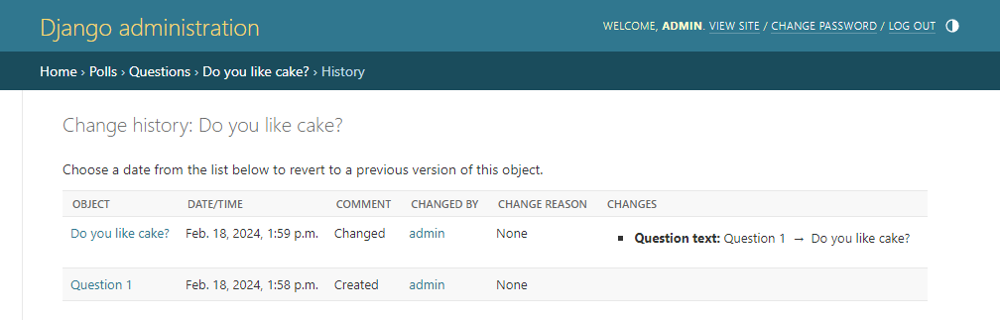
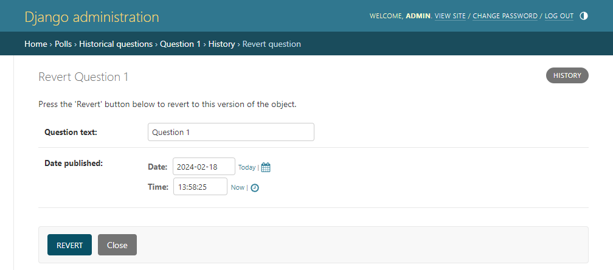
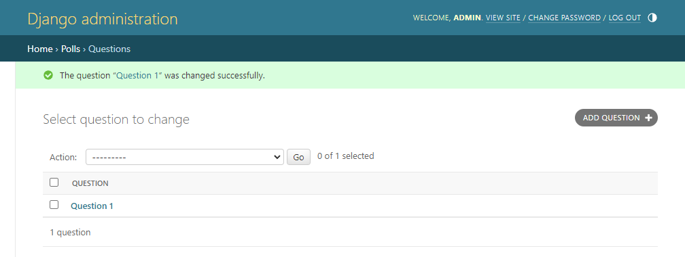
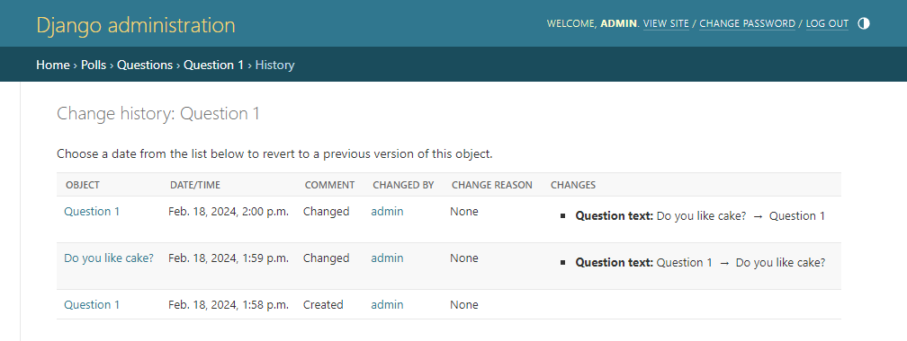
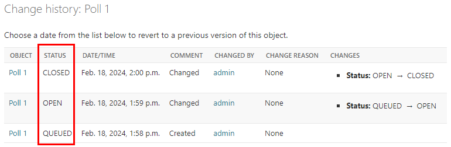
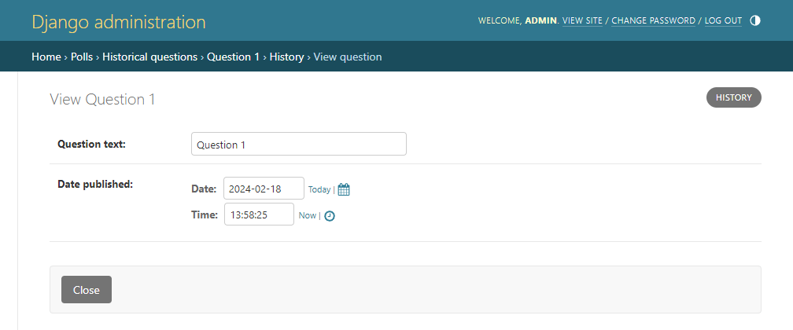

Admin Integration
-----------------

To allow viewing previous model versions on the Django admin site, inherit from
the ``simple_history.admin.SimpleHistoryAdmin`` class when registering your
model with the admin site.

This will replace the history object page on the admin site and allow viewing
and reverting to previous model versions.  Changes made in admin change forms
will also accurately note the user who made the change.

Clicking on an object presents the option to revert to that version of the object.

(The object is reverted to the selected state)

Reversions like this are added to the history.

An example of admin integration for the ``Poll`` and ``Choice`` models:

.. code-block:: python

    from django.contrib import admin
    from simple_history.admin import SimpleHistoryAdmin
    from .models import Poll, Choice

    admin.site.register(Poll, SimpleHistoryAdmin)
    admin.site.register(Choice, SimpleHistoryAdmin)

Changing a history-tracked model from the admin interface will automatically record the user who made the change (see :doc:`/user_tracking`).

Previewing and confirming a recovery
~~~~~~~~~~~~~~~~~~~~~~~~~~~~~~~~~~~~

A historical version's admin form offers a **Preview recovery** action. The
recovery preview page shows:

* the scalar fields of the object that differ between the current state and
  the historical state, and
* every history-tracked reverse association (for example a group quota
  attached to a configuration) that existed at the time of the historical
  record, together with its current status:

  - *Recoverable*: the association still exists, its related objects are the
    same business entities, and its fields can be restored;
  - *Already up to date*: nothing needs to change for this association;
  - *Cannot be recovered*: the association or one of its related objects can no
    longer be identified.

Related objects are identified by their primary key, but their identity is
additionally verified through a stable business field. This matters when a
related object was deleted and a *different* object later reused the same
database primary key: the new object must never inherit the historical
association. By default the first unique, non-primary field of the related
model is used as the identity field. You can configure explicit fields on the
admin class with ``recovery_identity_fields``, which maps
``app_label.model_name`` to a field name:

.. code-block:: python

    class ReconciledConfigAdmin(SimpleHistoryAdmin):
        recovery_identity_fields = {"myapp.billinggroup": "code"}

The preview itself never writes anything. Two explicit actions are offered:

* **Recover everything** restores the object's scalars and *all* historical
  associations. It is disabled (and rejected on the server side) when at least
  one association cannot be recovered, or when the current data changed after
  the preview was taken; in either case no data is modified.
* **Recover recognizable associations only** restores the object's scalars and
  only the associations that are still identifiable. Associations that cannot
  be recovered are skipped and reported in the success message.

Every recovery runs inside a single atomic transaction, so a failure while
writing any scalar or association rolls back all changes. The returned result
references the newly created historical versions, allowing the restored state
to be re-queried through the normal history views.

The feature can be disabled for an admin class by setting
``recovery_enabled = False``. The regular history browsing and the existing
revert form are unaffected.

Displaying custom columns in the admin history list view
~~~~~~~~~~~~~~~~~~~~~~~~~~~~~~~~~~~~~~~~~~~~~~~~~~~~~~~~

By default, the history log displays one line per change containing

* a link to the detail of the object at that point in time
* the date and time the object was changed
* a comment corresponding to the change
* the author of the change

You can add other columns (for example the object's status to see
how it evolved) by adding a ``history_list_display`` array of fields to the
admin class.

.. code-block:: python

    from django.contrib import admin
    from simple_history.admin import SimpleHistoryAdmin
    from .models import Poll, Choice

    class PollHistoryAdmin(SimpleHistoryAdmin):
        list_display = ["id", "name", "status"]
        history_list_display = ["status"]
        search_fields = ['name', 'user__username']
        history_list_per_page = 100

    admin.site.register(Poll, PollHistoryAdmin)
    admin.site.register(Choice, SimpleHistoryAdmin)

Changing the page size in the admin history list view
~~~~~~~~~~~~~~~~~~~~~~~~~~~~~~~~~~~~~~~~~~~~~~~~~~~~~

By default, the history list view of ``SimpleHistoryAdmin`` shows the last 100 records.
You can change this by adding a `history_list_per_page` attribute to the admin class.

.. code-block:: python

    from django.contrib import admin
    from simple_history.admin import SimpleHistoryAdmin
    from .models import Poll

    class PollHistoryAdmin(SimpleHistoryAdmin):
        # history_list_per_page defaults to 100
        history_list_per_page = 200

    admin.site.register(Poll, PollHistoryAdmin)

Customizing the History Admin Templates
~~~~~~~~~~~~~~~~~~~~~~~~~~~~~~~~~~~~~~~

If you'd like to customize the HTML of ``SimpleHistoryAdmin``'s object history pages,
you can override the following attributes with the names of your own templates:

- ``object_history_template``: The main object history page, which includes (inserts)
  ``object_history_list_template``.
- ``object_history_list_template``: The table listing an object's historical records and
  the changes made between them.
- ``object_history_form_template``: The form pre-filled with the details of an object's
  historical record, which also allows you to revert the object to a previous version.

If you'd like to only customize certain parts of the mentioned templates, look for
``block`` template tags in the source code that you can override - like the
``history_delta_changes`` block in ``simple_history/object_history_list.html``,
which lists the changes made between each historical record.

Customizing Context
^^^^^^^^^^^^^^^^^^^

You can also customize the template context by overriding the following methods:

- ``render_history_view()``: Called by both ``history_view()`` and
  ``history_form_view()`` before the templates are rendered. Customize the context by
  changing the ``context`` parameter.
- ``history_view()``: Returns a rendered ``object_history_template``.
  Inject context by calling the super method with the ``extra_context`` argument.
- ``get_historical_record_context_helper()``: Returns an instance of
  ``simple_history.template_utils.HistoricalRecordContextHelper`` that's used to format
  some template context for each historical record displayed through ``history_view()``.
  Customize the context by extending the mentioned class and overriding its methods.
- ``history_form_view()``: Returns a rendered ``object_history_form_template``.
  Inject context by calling the super method with the ``extra_context`` argument.

Disabling the option to revert an object
~~~~~~~~~~~~~~~~~~~~~~~~~~~~~~~~~~~~~~~~

By default, an object can be reverted to its previous version. To disable this option
globally, update your settings with the following:

.. code-block:: python

    SIMPLE_HISTORY_REVERT_DISABLED = True

When ``SIMPLE_HISTORY_REVERT_DISABLED`` is set to ``True``, the revert button is removed from the form.

Enforcing history model permissions in Admin
~~~~~~~~~~~~~~~~~~~~~~~~~~~~~~~~~~~~~~~~~~~~

To make the Django admin site evaluate history model permissions explicitly,
update your settings with the following:

.. code-block:: python

    SIMPLE_HISTORY_ENFORCE_HISTORY_MODEL_PERMISSIONS = True

By default, ``SIMPLE_HISTORY_ENFORCE_HISTORY_MODEL_PERMISSIONS`` is set to ``False``.
When set to ``False``, permissions applied to the ``Poll`` model
(from the examples above), also apply to the history model.
That is, granting view and change permissions to the ``Poll`` model
implicitly grants view and change permissions to the ``Poll`` history model.

The user below has view and change permissions to the ``Poll`` model and the ``Poll``
history model in admin.

.. code-block:: python

    user.user_permissions.clear()
    user.user_permissions.add(
        Permission.objects.get(codename="view_poll"),
        Permission.objects.get(codename="change_poll"),
    )

The user below has view permission to the ``Poll`` model and the ``Poll`` history model
in admin.

.. code-block:: python

    user.user_permissions.clear()
    user.user_permissions.add(
        Permission.objects.get(codename="view_poll"),
    )

When ``SIMPLE_HISTORY_ENFORCE_HISTORY_MODEL_PERMISSIONS`` is set to ``True``,
permissions to history models are assigned and evaluated explicitly.

The user below *does not have* view permission to the ``Poll`` history model in admin,
even though they *have* view permission to the ``Poll`` model.

.. code-block:: python

    # SIMPLE_HISTORY_ENFORCE_HISTORY_MODEL_PERMISSIONS = True in settings
    user.user_permissions.clear()
    user.user_permissions.add(
        Permission.objects.get(codename="view_poll"),
    )

The user below has view permission to the ``Poll`` model and the ``Poll``
history model.

.. code-block:: python

    # SIMPLE_HISTORY_ENFORCE_HISTORY_MODEL_PERMISSIONS = True in settings
    user.user_permissions.clear()
    user.user_permissions.add(
        Permission.objects.get(codename="view_poll"),
        Permission.objects.get(codename="view_historicalpoll"),
    )

The user below has view permission to the ``Poll`` history model, but will need to
access the page with a direct URL, since the ``Poll`` model will not be listed on
the admin application index page, nor the ``Poll`` changelist.

.. code-block:: python

    # SIMPLE_HISTORY_ENFORCE_HISTORY_MODEL_PERMISSIONS = True in settings
    user.user_permissions.clear()
    user.user_permissions.add(
        Permission.objects.get(codename="view_historicalpoll"),
    )
